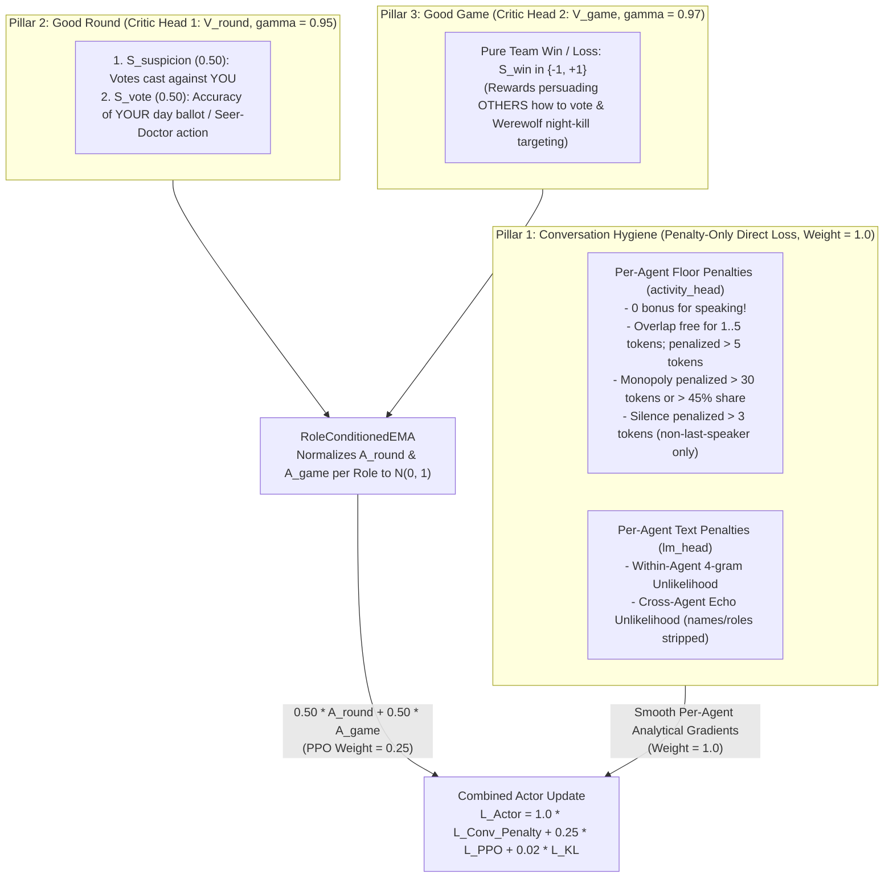
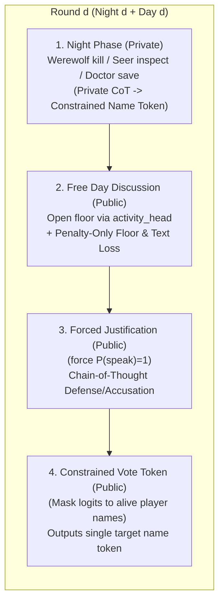
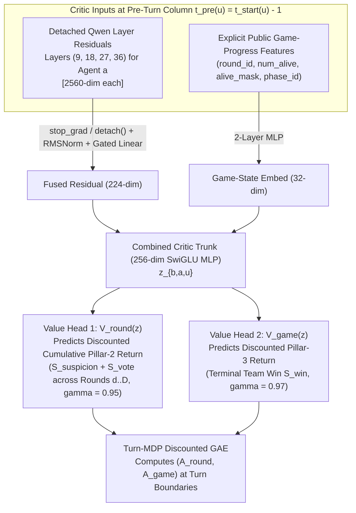

# Werewolf Stage-B RL, Streamlined 3-Pillar Reward & Multi-Layer Residual Critic Master Plan

This document is the authoritative architectural and algorithmic specification for training `MatrixQwenForCausalLM` in the multi-agent Werewolf reinforcement learning environment (Stage B).

---

## 1. Executive Summary & Core Design Decisions

Every component in this plan has been stripped of redundancy, discontinuous cliffs, and reward-hacking loopholes:

1. **No Hard-Failure Cliffs ("Valleys of Failure"):**
   We do **not** use a discontinuous threshold that zeros out strategic rewards when conversation metrics dip. Zeroing out rewards across a boundary creates a flat zero-gradient plateau where a degraded policy has no gradient pointing back out. Instead, conversation quality is enforced continuously via a **high-weight ($\lambda_{\text{conv}} = 1.0$), smooth direct penalty loss** that always provides a restoring gradient on the exact offending agent.
2. **Pillar 1 (Conversation Hygiene) is Strictly Penalty-Only ($\mathcal{L}_{\text{Conversation}} \ge 0$, Zero Speaking Bonus):**
   We **never** give positive reward simply for speaking, continuing a turn, or taking the floor—because positive speaking bonuses invite reward-hacking (babbling or rapid 1-word turn ping-ponging). Inside the healthy human operating envelope, **all conversation penalties are strictly $0.0$**:
   - **Overlap:** Free for **$1\text{--}5$ tokens** (`overlap_grace = 5.0`); smooth penalty kicks in **only after $> 5$ consecutive tokens** of overlap, attributed strictly to the intruding/non-yielding agent (never punishing the legitimate floor owner).
   - **Monopoly:** Free up to **$30$ tokens** per turn and **$45\%$** share of the round's spoken tokens; smooth penalty ramps up only on the rambling/monopolizing agent above those caps.
   - **Dead-Air Silence:** Free for **$1\text{--}3$ tokens** between turns; smooth penalty nudges quiet living listeners only when table-wide silence exceeds $3$ columns.
   - **Repetition & Echo:** Pure unlikelihood penalty on within-agent repeated 4-grams and cross-speaker echo (with player names and role titles stripped).
3. **Pillar 2 (Good Round) Uses Only Two Orthogonal Signals (`S_suspicion` and `S_vote`):**
   - We **removed `S_survival`** because being voted out is just a noisy discrete step-function of `votes_against`, which `S_suspicion` already measures continuously.
   - We **removed Werewolf night-agreement bonuses** (`S_night` for Werewolves) because forcing agreement is artificial; Werewolf night kills should be judged purely by whether they help win the game (Pillar 3).
   - **What remains in Pillar 2 (`50/50` split):**
     1. **`S_suspicion` ($50\%$):** Continuous fraction of votes cast *against you* in Round $d$ (evaluates how persuasive and low-suspicion your public speech was).
     2. **`S_vote` ($50\%$):** Accuracy of *your* discrete day ballot (or Seer/Doctor night target choice).
4. **Pillar 3 (Good Game) is Pure Team Victory (`S_win` $\in \{-1, +1\}$):**
   - We **removed `S_margin`, `S_speed`, and `S_alive_dur`** because surviving more rounds is already rewarded by collecting more rounds of Pillar 2, and winning in fewer rounds is already naturally rewarded by exponential discounting $\gamma_{\text{game}}^{U_a - u}$.
   - **Why pure `S_win` is essential alongside Pillar 2:** Pillar 2 only cares about votes cast *against you* (`S_suspicion`) and *your own solitary ballot* (`S_vote`). Without `S_win`, a Seer or smart Villager's optimal Pillar-2 strategy is to stay silent, avoid all heat (`S_suspicion = +1`), cast one lonely correct vote (`S_vote = +1`), and let the uninformed Village lose! `S_win` is the **only** signal that rewards a player for **persuading the rest of the table how to vote**, guides **Werewolf night-kill targeting**, and rewards **tactical self-sacrifice**.
5. **Lean Multi-Layer Residual Critic (`V_round` and `V_game` Only — Auxiliary Role Head Removed):**
   - Taps detached Qwen3 hidden states at layers `(9, 18, 27, 36)` plus explicit public game-progress features `(round_id, num_alive, alive_mask, phase_id)` into a 256-dim trunk with **only 2 scalar output heads**: **`V_round`** and **`V_game`**.
   - We **removed the Auxiliary Role-Prediction Head** because: (a) the `detach()` barrier prevents critic gradients from ever teaching Qwen/the Actor, (b) roles are genuinely unidentifiable from public text at the start of early turns (injecting high-entropy noise), and (c) removing it dedicates 100% of the 256-dim critic trunk's capacity to accurate value estimation.



---

## 2. System Foundations: Dual Action Space, Parameter Groups & Game-State Conditioning

### 2.1 Factored Dual Action Space at Every Matrix Cell $(b, a, t)$
In `MatrixQwenForCausalLM`, inputs are shaped $[B, A, T]$ around `Qwen/Qwen3-4B-Instruct-2507` ($L = 36$ layers, hidden size $H = 2560$, vocab $V = 151,936$). At every cell $(b, a, t)$:
- **Floor / Activity Policy (`activity_head`):** Outputs logit $\alpha_{b,a,t}$ and speak probability $q_{b,a,t} = \sigma(\alpha_{b,a,t}) = P(s_{b,a,t+1} = 1 \mid \mathcal{H}_{\le t})$, where $s_{b,a,t+1} \in \{0, 1\}$ is the binary decision to speak ($1$) or yield ($0$).
- **Content Policy (`lm_head`):** Outputs token distribution $P_\theta(v_{b,a,t+1} \mid s_{b,a,t+1} = 1, \mathcal{H}_{\le t})$ over vocabulary $V$ (or over a **constrained subset of valid living player-name tokens** $\mathcal{V}_{\text{valid}} \subset V$ during voting/night action steps).

The joint log-probability of an agent's realized action $a_{b,a,t} = (s_{b,a,t}, v_{b,a,t})$ factors as:

$$
\log \pi_\theta(a_{b,a,t} \mid \mathcal{H}_{<t}) = (1 - s_{b,a,t}) \log(1 - q_{b,a,t}) + s_{b,a,t} \Big(\log q_{b,a,t} + \log P_\theta(v_{b,a,t} \mid \mathcal{H}_{<t})\Big)
$$

*(On columns where speaking is forced by the environment—such as forced pre-vote justification or mandatory voting—$s_{b,a,t}=1$ is fixed by the environment, so only $\log P_\theta(v_{b,a,t} \mid \mathcal{H}_{<t})$ receives policy gradients).*

### 2.2 Explicit Public Game-Progress Conditioning (`round_id`, `num_alive`, `alive_mask`, `phase_id`)
Expected future returns and optimal strategy depend heavily on how many players remain alive and what round it is (e.g., 3 players alive in Round 3 means the current vote ends the game, whereas 6 players alive in Round 1 means multiple rounds remain). Because token embeddings and column RoPE only encode token identity and column index $t$, we inject explicit public game-state features $g_{b,t}$ into **both** the Actor and Critic:
- **Public Game-State Features $g_{b,t}$:**
  1. `round_id` $d \in \{1, \dots, D_{\max}\}$ (normalized by $D_{\max}$).
  2. `num_alive` $N_{\text{alive}}(b, t) \in \{2, \dots, A_{\max}\}$ and survival ratio $N_{\text{alive}} / A$.
  3. `alive_mask` $\mathbf{m}^{\text{alive}}_{b, :, t} \in \{0, 1\}^{A_{\max}}$ (which specific player seats are currently alive vs. eliminated).
  4. `phase_id` $\in \{\text{Night}, \text{Discussion}, \text{Justification}, \text{Vote}\}$ (one-hot encoded).
- **In the Actor (`interface` group):** A lightweight `GameStateEmbedding` module maps `(round_id, num_alive, phase_id)` into $\mathbb{R}^H$ (zero-initialized at its output projection so Step 0 is identical to the SFT checkpoint) and adds it to `inputs_embeds` alongside `agent_embeddings`, paired with a public moderator header at the start of each round (`"[Round 2 | 4 players alive: Alpha, Beta, Gamma, Delta]"`).
- **In the Critic (`MultiLayerResidualCritic`):** A 32-dim MLP encodes $g_{b,t}$ and concatenates it directly with the fused Qwen layer residuals inside the critic's 256-dim trunk.

### 2.3 The Four Optimizer Parameter Groups (`main.py`)
1. **`interface` (`args.interface_lr`):** Wrapper modules outside Qwen (`agent_embeddings`, `agent_attention` QKV conditioners, `inactive_embedding`, `activity_head`, `agent_dynamic_state` GRU, and `game_state_embedding`).
2. **`lora` (`args.lora_lr`):** Low-rank adapters (`lora_A`, `lora_B`) on Qwen3's `q_proj`, `k_proj`, `v_proj`, `o_proj`.
3. **`base` (`args.base_lr`):** Any directly unfrozen full-rank Qwen3 layers (anchored by L2-SP; empty in pure LoRA runs).
4. **`critic` (`args.critic_lr`, New for Stage B):** Parameters of `MultiLayerResidualCritic`, completely isolated from the Qwen backbone via `detach()`.

---

## 3. Game Flow, Turn-MDP Timeline & Constrained Voting

### 3.1 Turn-Level Markov Game Timeline (SPIRAL Formulation)
Following **SPIRAL** (`arXiv:2506.24119`):
- From Agent $a$'s perspective, **an action is a complete utterance (turn) $u \in \{1, \dots, U_a\}$ or a discrete vote**.
- Everything that **other players $a' \neq a$** say between Agent $a$'s turns is part of the **environment transition** $T(s_{a, u}, a_{a, u}) \to s_{a, u+1}$.
- Therefore, Agent $a$'s strategic discount factor only steps across Agent $a$'s own turns $u = 1, \dots, U_a$—it is **never diluted by how many columns or turns other players take**.

### 3.2 Four-Stage Structure of Every Round $d \in \{1, \dots, D\}$


1. **Night Phase (Private Columns, `input_private_mask=True`):**
   - **Werewolves (`visible_to=werewolves`):** Coordinate privately and emit a constrained night-kill player-name token $v^{\text{kill}}_{a,d} \in \mathcal{V}_{\text{alive\_non\_ww}}$.
   - **Seer (`visible_to=[seer]`):** Reasons privately and emits a constrained inspect player-name token $v^{\text{seer}}_{a,d} \in \mathcal{V}_{\text{alive\_other}}$; the environment appends the private inspection result.
   - **Doctor (`visible_to=[doctor]`):** Emits a constrained save player-name token $v^{\text{doc}}_{a,d} \in \mathcal{V}_{\text{alive}}$.
2. **Free Day Discussion (Public Columns):**
   - Open floor governed by `activity_head` (with silence-rescue controls in `model/generation.py`).
3. **Forced Pre-Vote Justification (`force_speaker = True`, $P(\text{speak}) = 1$):**
   - Before voting, each living player is forced to speak so they articulate their defense and accusation reasoning in public context.
4. **Constrained Vote Name Token (`t_vote`):**
   - Immediately after the justification, `lm_head` logits are masked to only the valid living player-name token IDs $\mathcal{V}_{\text{valid}}(d)$:

$$
P_\theta(v \mid \mathcal{H}) = \text{softmax}\!\big(\text{logits}_{\mathcal{V}_{\text{valid}}(d)}\big)
$$

   - Because the defense precedes the vote token, the vote distribution is causally conditioned on the player's own articulated reasoning.
   - **Exact Zero-Variance Softmax Baseline on the Vote Token:** Because $\mathcal{V}_{\text{valid}}(d)$ is a small set of $K \le 8$ living player names and we know $S_{\text{vote}}(v') \in \{-1, +1\}$ for every candidate $v' \in \mathcal{V}_{\text{valid}}(d)$, we can compute the exact expected vote value directly from the softmax probabilities:

$$
A^{\text{vote\_tok}}_{b,a,t_{\text{vote}}} = S_{\text{vote}}(v_{\text{sampled}}) - \sum_{v' \in \mathcal{V}_{\text{valid}}(d)} P_{\theta_{\text{old}}}(v' \mid \mathcal{H}) \, S_{\text{vote}}(v')
$$

---

## 4. Detailed Specification of the 3 Reward/Loss Pillars

### 4.1 Pillar 1: Good Quality Conversation (Penalty-Only Direct Loss $\mathcal{L}_{\text{Conversation}} \ge 0$)

#### A. Per-Agent Attribution Table (Never Punish Innocent Agents)
| Problematic Behavior | Who Pays the Penalty (Attributed Agent $a$) | Who Pays Zero (`0.0`) Penalty |
| :--- | :--- | :--- |
| **Sustained Interruption Overlap ($> 5$ tokens)** when Agent $a^*$ already owned the floor at onset (within `speak_grace = 30`) | **Only the intruding agent(s) $a \neq a^*$** who keep speaking past 5 overlapping tokens. | **The legitimate floor owner $a^*$** (protected while within `speak_grace`) and all silent agents! |
| **Sustained Collision Overlap ($> 5$ tokens)** when two agents started speaking simultaneously after silence | Both colliding agents are free for tokens $1\text{--}5$; **whichever agent(s) refuse to yield after token 5** pay the ramping penalty. | All silent agents. |
| **Sustained Turn Monopoly ($> 30$ tokens or $> 45\%$ round share)** | **Only the rambling/monopolizing agent $a$** on their `activity_head` probability $q_{b,a,t}$. | All other agents $a' \neq a$. |
| **Sustained Dead-Air Silence ($> 3$ silent columns)** | **Living non-previous speakers ($a \neq \text{last\_owner}$)**, weighted by $1 - \text{share}_{b,a,t}$ so the quietest players are nudged most. | **The speaker who just finished (`last_owner`)** (so they aren't forced to self-resume) and eliminated players. |
| **Self-Repetition & Cross-Agent Echo** | **Only Agent $a$'s `lm_head`** at the specific repeated/echoed token columns. | All other agents. |

#### B. Exact Mathematical Equations for Pillar 1 (`L_Conversation`)
At column $t$, let $q_{b,a,t} = \sigma(\alpha_{b,a,t-1})$ be Agent $a$'s probability of speaking at column $t$, and let $p^{\text{other}}_{b,a,t} = 1 - \prod_{a' \neq a}(1 - q_{b,a',t})$ be the probability that at least one other agent speaks at column $t$:

1. **Sustained Overlap Penalty (Grace $g_{\text{ov}} = 5.0$ tokens):**
   Let $\omega_{b,a,t-1}$ be the number of consecutive columns Agent $a$ has been overlapping as a non-protected speaker.
   - For $\omega_{b,a,t-1} \le 5.0$: **$\mathcal{L}^{\text{overlap}}_{b,a,t} = 0.0$**.
   - For $\omega_{b,a,t-1} > 5.0$:

$$
\mathcal{L}^{\text{overlap}}_{b,a,t} = w_{\text{ov}}^{\max} \cdot \left(1 - \exp\!\left(-\frac{\max(0,\; \omega_{b,a,t-1} - 5.0)}{\tau_{\text{ov}}}\right)\right) \cdot q_{b,a,t} \cdot p^{\text{other}}_{b,a,t}
$$

2. **Sustained Monopoly Penalty (Turn Grace $g_{\text{spk}} = 30.0$ tokens, Round Share Cap $\tau_{\text{share}} = 0.45$):**
   Let $x_{b,a,t-1}$ be Agent $a$'s current consecutive sole-speaker run length, and $\text{share}_{b,a,t-1}$ be Agent $a$'s fraction of all spoken tokens in Round $d$ so far.
   - For $x_{b,a,t-1} \le 30.0$ and $\text{share}_{b,a,t-1} \le 0.45$: **$\mathcal{L}^{\text{monopoly}}_{b,a,t} = 0.0$**.
   - Otherwise:

$$
\mathcal{L}^{\text{monopoly}}_{b,a,t} = \left[ w_{\text{len}} \left(1 - \exp\!\left(-\frac{\max(0,\; x_{b,a,t-1} - 30.0)}{\tau_{\text{spk}}}\right)\right) + w_{\text{share}} \max\!\left(0,\; \frac{\text{share}_{b,a,t-1} - 0.45}{0.25}\right) \right] \cdot q_{b,a,t}
$$

3. **Sustained Dead-Air Silence Penalty (Pause Grace $g_{\text{sil}} = 3.0$ tokens):**
   Let $z_{t-1}$ be the number of consecutive all-silent columns across the table.
   - For $z_{t-1} \le 3.0$: **$\mathcal{L}^{\text{silence}}_{b,a,t} = 0.0$**.
   - For $z_{t-1} > 3.0$:

$$
\mathcal{L}^{\text{silence}}_{b,a,t} = w_{\text{sil}}^{\max} \cdot \left(1 - \exp\!\left(-\frac{\max(0,\; z_{t-1} - 3.0)}{\tau_{\text{sil}}}\right)\right) \cdot \mathbb{I}[a \neq \text{last\_owner}] \cdot (1 - \text{share}_{b,a,t-1}) \cdot (1 - q_{b,a,t})
$$

4. **Within-Agent Repetition & Cross-Agent Echo Unlikelihood Penalties (`lm_head`):**
   - **Self-Repetition ($\mathcal{L}_{\text{SelfRep}}$):** Unlikelihood loss $-\log(1 - P_\theta(v_{\text{rep}} \mid \mathcal{H}_{<t}))$ on tokens Agent $a$ already used in their own last $W_{\text{self}} = 20$ spoken columns (`recent_token_repetition_loss` in `model/matrix_qwen.py`).
   - **Cross-Agent Echo ($\mathcal{L}_{\text{CrossEcho}}$):** Same unlikelihood loss applied when Agent $a$ repeats $\ge 2$ consecutive non-exempt tokens spoken by *another* agent $a' \neq a$ in the last $W_{\text{echo}} = 32$ columns, where player names (`Alpha`, `Beta`, ...) and role/game keywords (`Werewolf`, `Seer`, `Doctor`, `Villager`, `Minion`, `vote`) are **exempt** so accusing the same player or discussing roles is never penalized.

5. **Total Pillar 1 Loss:**

$$
\mathcal{L}_{\text{Conversation}}(\theta) = \frac{1}{N_{\text{alive}}} \sum_{b,a,t} \Big(\mathcal{L}^{\text{overlap}}_{b,a,t} + \mathcal{L}^{\text{monopoly}}_{b,a,t} + \mathcal{L}^{\text{silence}}_{b,a,t}\Big) + \lambda_{\text{rep}} \mathcal{L}_{\text{SelfRep}}(\theta) + \lambda_{\text{echo}} \mathcal{L}_{\text{CrossEcho}}(\theta) \ge 0
$$

---

### 4.2 Pillar 2: Good Round Reward (`S_suspicion` + `S_vote` Only — Critic Head 1: `V_round`)

At the end of every Round $d \in \{1, \dots, D\}$, each active player $a$ receives a Round Reward $r^{\text{round}}_{b,a,d} \in [-1, +1]$ composed strictly of **Suspicion** and **Vote Accuracy**:

$$
r^{\text{round}}_{b,a,d} = 0.50 \cdot S_{\text{suspicion}}(b, a, d) + 0.50 \cdot S_{\text{vote}}(b, a, d) \in [-1, +1]
$$

1. **`S_suspicion(b, a, d)` $\in [-1, +1]$ (Weight `0.50` — Votes Cast Against You):**

$$
S_{\text{suspicion}}(b, a, d) = 1.0 - 2.0 \cdot \frac{\text{votes\_against}(b, a, d)}{\max(1,\; N_{\text{alive}}(b, d) - 1)}
$$

   - $0$ votes against you scores $+1.0$; receiving half the table's votes scores $0.0$; receiving every possible vote scores $-1.0$.
   - Directly rewards **persuasive self-defense, deflecting suspicion, and building trust** during Round $d$'s discussion.

2. **`S_vote(b, a, d)` $\in [-1, +1]$ (Weight `0.50` — Accuracy of Your Target Choice):**
   - **Day Ballot ($v^{\text{vote}}_{b,a,d}$):**
     - **Village Team (`Villager`, `Seer`, `Doctor`):** $+1.0$ if Agent $a$ voted for a true `Werewolf` (or `Minion`); $-1.0$ if Agent $a$ voted for a fellow `Villager`.
     - **Werewolf Team (`Werewolf`, `Minion`):** $+1.0$ if Agent $a$ voted for a `Villager`; $-1.0$ if Agent $a$ voted for a fellow `Werewolf`.
   - **Night Power Target (`Seer` and `Doctor` only, blended with their day ballot):**
     - **Seer:** $+1.0$ if the Seer inspected a living, *previously uninspected* player (new information gain); $-1.0$ if the Seer re-inspected an already-checked player.
     - **Doctor:** $+1.0$ if the Doctor protected the player targeted by Werewolves (or a revealed Seer); $0.0$ otherwise.

---

### 4.3 Pillar 3: Good Game Reward (Pure Team Victory `S_win` — Critic Head 2: `V_game`)

At the end of the final Round $D$, each player $a$ receives the pure terminal team outcome $R^{\text{game}}_{b,a} \in \{-1, +1\}$:

$$
R^{\text{game}}_{b,a} = S_{\text{win}}(b, a) = \begin{cases} +1.0 & \text{if Agent } a\text{'s team (`Village` or `Werewolf`) wins the game,} \\ -1.0 & \text{if Agent } a\text{'s team loses the game.} \end{cases}
$$

**Why `S_win` (with Discounting $\gamma_{\text{game}} = 0.97$) Captures Everything Needed at the Game Level:**
1. **Forces Table-Wide Persuasion (Solves the "Silent Seer" Problem):** Because Pillar 2 only rewards your *own* ballot (`S_vote`) and avoiding votes against *yourself* (`S_suspicion`), `S_win` is the crucial signal that forces Villagers and the Seer to **convince the rest of the village** to vote out the Werewolves together.
2. **Guides Werewolf Night Kills:** Without hand-coded night rules for Werewolves, `S_win` teaches Werewolves to eliminate the most dangerous/deductive Villagers or suspected Seer at night.
3. **Automatically Rewards Faster Wins & Longer Survival via Discounting:** Because `V_game` discounts `S_win` by $\gamma_{\text{game}}^{U_a - u}$ per turn, winning in fewer rounds automatically produces a higher discounted return at Turn 1 than winning slowly, with zero need for a separate `S_speed` or `S_margin` formula.

---

## 5. Lean Multi-Layer Residual Critic (`V_round` & `V_game` Only)

### 5.1 Architecture Diagram
During `MatrixQwenForCausalLM.forward(..., output_hidden_states=True)`, Qwen outputs hidden states $(h^{(0)}, \dots, h^{(36)})$, each shaped $[B, T \cdot A, H]$ ($H = 2560$).



### 5.2 Exact Discounted Return & GAE Equations

Let $u \in \{1, \dots, U_a\}$ index Agent $a$'s turns across the entire game, evaluated at pre-turn column $t_{\text{pre}}(u) = t_{\text{start}}(u) - 1$ (strictly *before* Turn $u$'s tokens are spoken, preventing action leakage):

1. **Head 1 (`V_round`, $\gamma_{\text{round}} = 0.95, \lambda_{\text{round}} = 0.95$):**
   - Define step reward $\tilde{r}^{\text{round}}_{b,a,u} = r^{\text{round}}_{b,a,d}$ if Turn $u$ is Agent $a$'s final turn in Round $d$, and $0$ on earlier discussion turns within Round $d$.
   - **Discounted Return:**

$$
G^{\text{round}}_{b,a,u} = \sum_{k=0}^{U_a - u} \gamma_{\text{round}}^k \, \tilde{r}^{\text{round}}_{b,a,u+k}
$$

   - **TD Residual & GAE Advantage (`A_round`):**

$$
\delta^{\text{round}}_{b,a,u} = \tilde{r}^{\text{round}}_{b,a,u} + \gamma_{\text{round}} \mathbb{I}[u < U_a] \, \hat{V}^{\text{round}}_\phi(z_{b,a,u+1}) - \hat{V}^{\text{round}}_\phi(z_{b,a,u})
$$

$$
A^{\text{round}}_{b,a,u} = \sum_{k=0}^{U_a - u} (\gamma_{\text{round}} \lambda_{\text{round}})^k \, \delta^{\text{round}}_{b,a,u+k}
$$

2. **Head 2 (`V_game`, $\gamma_{\text{game}} = 0.97, \lambda_{\text{game}} = 0.95$):**
   - Define step reward $\tilde{r}^{\text{game}}_{b,a,u} = S_{\text{win}}(b, a)$ on Agent $a$'s final turn $u = U_a$ of the game, and $0$ for $u < U_a$.
   - **Discounted Return:**

$$
G^{\text{game}}_{b,a,u} = \gamma_{\text{game}}^{U_a - u} \, S_{\text{win}}(b, a)
$$

   - **TD Residual & GAE Advantage (`A_game`):**

$$
\delta^{\text{game}}_{b,a,u} = \tilde{r}^{\text{game}}_{b,a,u} + \gamma_{\text{game}} \mathbb{I}[u < U_a] \, \hat{V}^{\text{game}}_\phi(z_{b,a,u+1}) - \hat{V}^{\text{game}}_\phi(z_{b,a,u})
$$

$$
A^{\text{game}}_{b,a,u} = \sum_{k=0}^{U_a - u} (\gamma_{\text{game}} \lambda_{\text{game}})^k \, \delta^{\text{game}}_{b,a,u+k}
$$

3. **Critic Loss Function (Pure Value Huber Loss, No Auxiliary Head):**
   With targets $V^{\text{target}}_{\text{round}} = A^{\text{round}} + \hat{V}^{\text{round}}_{\phi_{\text{old}}}$ and $V^{\text{target}}_{\text{game}} = A^{\text{game}} + \hat{V}^{\text{game}}_{\phi_{\text{old}}}$:

$$
\mathcal{L}_{\text{Critic}}(\phi) = \mathcal{L}_{\text{Huber}}\!\big(\hat{V}^{\text{round}}_\phi(z),\; V^{\text{target}}_{\text{round}}\big) + \mathcal{L}_{\text{Huber}}\!\big(\hat{V}^{\text{game}}_\phi(z),\; V^{\text{target}}_{\text{game}}\big)
$$

---

## 6. Role-Conditioned EMA Normalization & 3-Pillar Balancing

### 6.1 How `RoleConditionedEMA` Normalizes `A_round` and `A_game` Across Roles
Because `Werewolf`, `Seer`, `Doctor`, `Villager`, and `Minion` have asymmetric survival rates and baseline returns, normalizing across all players together causes "thinking collapse" (SPIRAL, ICLR 2026). Instead, `RoleConditionedEMA` maintains persistent per-role running mean and variance buffers across rollout steps:
1. **Updated Once Per Outer Rollout Step (Never Per Inner Mini-Batch):**
   Called once on the newly collected rollout batch before the 2–4 inner PPO epochs begin.
2. **Sample-Count-Weighted Decay ($\beta_r = 1 - 0.95^{n_r / 16}$):**
   Prevents a batch with only 1 `Seer` from causing a noisy jump in the `Seer` baseline.
3. **Adam-Style Bias Correction ($\frac{1}{1 - p_r}$):**
   Acts like an exact pooled average in early steps and smoothly transitions into a ~20-step sliding window that tracks the model as it improves:

$$
\tilde{A}^{\text{round}}_{b,a,u} = \frac{A^{\text{round}}_{b,a,u} - \hat{\mu}_{r, \text{round}}}{\sqrt{\hat{\sigma}^2_{r, \text{round}} + \epsilon}}, \qquad \tilde{A}^{\text{game}}_{b,a,u} = \frac{A^{\text{game}}_{b,a,u} - \hat{\mu}_{r, \text{game}}}{\sqrt{\hat{\sigma}^2_{r, \text{game}} + \epsilon}}
$$

### 6.2 How All 3 Pillars Are Balanced in the Final Actor Update
1. **50/50 Unit-Variance Combination of Pillar 2 (Round) and Pillar 3 (Game):**
   Because both $\tilde{A}^{\text{round}}$ and $\tilde{A}^{\text{game}}$ have exact standard deviation $1.0$ for every role, combining them 50/50 gives each equal gradient authority:

$$
A^{\text{strategic}}_{b,a,u} = 0.50 \, \tilde{A}^{\text{round}}_{b,a,u} + 0.50 \, \tilde{A}^{\text{game}}_{b,a,u}
$$

2. **Total Actor Loss (`1.00` Conversation Penalty vs. `0.25` Strategic PPO vs. `0.02` KL):**

$$
\mathcal{L}_{\text{Actor}}(\theta) = \mathbf{1.00} \cdot \mathcal{L}_{\text{Conversation}}(\theta) + \mathbf{0.25} \cdot \mathcal{L}_{\text{PPO-Clip}}\!\big(\theta;\; A^{\text{strategic}}_{b,a,u}\big) + \mathbf{0.02} \cdot D_{\text{KL}}\!\big(\pi_\theta \parallel \pi_{\text{ref}}\big)
$$

---

## 7. Complete Reference PyTorch Implementation

```python
from dataclasses import dataclass
import torch
import torch.nn as nn
import torch.nn.functional as F


@dataclass
class WerewolfRLConfig:
    # Top-level Actor Loss Balance
    lambda_conv: float = 1.00       # Pillar 1: Penalty-only conversation hygiene
    lambda_ppo: float = 0.25        # Pillars 2 & 3: Strategic Werewolf RL
    beta_kl: float = 0.02           # SFT reference policy KL anchor

    # Strategic Advantage Mix (applied after RoleConditionedEMA unit-std normalization)
    w_round_adv: float = 0.50       # Pillar 2: Good Round (S_suspicion + S_vote)
    w_game_adv: float = 0.50        # Pillar 3: Good Game (S_win)

    # Pillar 1: Per-Agent Penalty-Only Floor Thresholds
    overlap_grace: float = 5.0      # 1..5 tokens of overlap = 0 penalty; >5 penalized
    overlap_tau: float = 4.0
    overlap_max_weight: float = 3.5

    speak_grace: float = 30.0       # 1..30 tokens per turn = 0 penalty; >30 penalized
    speak_tau: float = 40.0
    monopoly_len_weight: float = 1.5
    share_cap: float = 0.45         # <=45% of round tokens = 0 penalty; >45% penalized
    share_weight: float = 2.0

    silence_grace: float = 3.0      # 1..3 silent columns = 0 penalty; >3 penalized
    silence_tau: float = 8.0
    silence_max_weight: float = 1.5

    # Pillar 2: Round Reward Internal Split (50/50)
    w_suspicion: float = 0.50
    w_vote: float = 0.50

    # Discounting & GAE
    gamma_round: float = 0.95
    lambda_round: float = 0.95
    gamma_game: float = 0.97
    lambda_game: float = 0.95


class MultiLayerResidualCritic(nn.Module):
    """Lean EAGLE/Ladder-style residual critic with 2 discounted value heads (V_round, V_game).

    Taps detached Qwen hidden states at layers (9, 18, 27, 36) + explicit public
    game-progress features (round_id, num_alive, phase_id, alive_mask).
    """

    def __init__(
        self,
        hidden_size: int = 2560,
        tap_layers: tuple[int, ...] = (9, 18, 27, 36),
        max_agents: int = 8,
        residual_dim: int = 224,
        game_feat_dim: int = 32,
        trunk_dim: int = 256,
        dropout: float = 0.1,
    ):
        super().__init__()
        self.tap_layers = tap_layers
        self.max_agents = max_agents

        self.layer_norms = nn.ModuleList([nn.RMSNorm(hidden_size) for _ in tap_layers])
        self.layer_projs = nn.ModuleList([
            nn.Linear(hidden_size, residual_dim, bias=False) for _ in tap_layers
        ])
        self.layer_gates = nn.Parameter(torch.zeros(len(tap_layers)))

        # Public game features: [round_norm, alive_ratio, phase_onehot(4), alive_mask(max_agents)]
        raw_game_dim = 2 + 4 + max_agents
        self.game_encoder = nn.Sequential(
            nn.Linear(raw_game_dim, game_feat_dim),
            nn.SiLU(),
            nn.Linear(game_feat_dim, game_feat_dim),
            nn.SiLU(),
        )

        self.trunk = nn.Sequential(
            nn.Linear(residual_dim + game_feat_dim, trunk_dim),
            nn.SiLU(),
            nn.Dropout(dropout),
            nn.Linear(trunk_dim, trunk_dim),
            nn.SiLU(),
        )

        # Only 2 scalar heads: V_round (Pillar 2) and V_game (Pillar 3)
        self.v_round_head = nn.Linear(trunk_dim, 1)
        self.v_game_head = nn.Linear(trunk_dim, 1)

    def forward(
        self,
        all_hidden_states: tuple[torch.Tensor, ...],  # tuple of [B, T*A, H]
        game_features: torch.Tensor,                  # [B, A, T, 2 + 4 + max_agents]
        num_agents: int,
        seq_len: int,
    ) -> dict[str, torch.Tensor]:
        b = all_hidden_states[-1].shape[0]
        weights = torch.softmax(self.layer_gates, dim=0)

        fused = 0.0
        for idx, layer_idx in enumerate(self.tap_layers):
            h = all_hidden_states[layer_idx].detach().to(self.layer_projs[idx].weight.dtype)
            fused = fused + weights[idx] * self.layer_projs[idx](self.layer_norms[idx](h))

        fused_matrix = fused.reshape(b, seq_len, num_agents, -1).permute(0, 2, 1, 3)
        game_emb = self.game_encoder(game_features.to(fused_matrix.dtype))
        z = self.trunk(torch.cat([fused_matrix, game_emb], dim=-1))  # [B, A, T, 256]

        return {
            "v_round": self.v_round_head(z).squeeze(-1),  # [B, A, T]
            "v_game": self.v_game_head(z).squeeze(-1),    # [B, A, T]
        }


class RoleConditionedEMA(nn.Module):
    """Sample-weighted, bias-corrected Role-Conditioned EMA normalizer for (A_round, A_game)."""

    def __init__(
        self,
        num_roles: int = 6,
        num_streams: int = 2,  # 0: A_round, 1: A_game
        ema_decay: float = 0.95,
        ref_count: float = 16.0,
        eps: float = 1e-5,
    ):
        super().__init__()
        self.num_roles = num_roles
        self.num_streams = num_streams
        self.ema_decay = ema_decay
        self.ref_count = ref_count
        self.eps = eps

        self.register_buffer("raw_mean", torch.zeros(num_roles, num_streams))
        self.register_buffer("raw_var", torch.zeros(num_roles, num_streams))
        self.register_buffer("decay_prod", torch.ones(num_roles, num_streams))

    @torch.no_grad()
    def normalize_and_update(
        self,
        advantages: torch.Tensor,      # [B, A, U, 2]
        role_ids: torch.LongTensor,    # [B, A]
        valid_mask: torch.BoolTensor,  # [B, A, U]
    ) -> torch.Tensor:
        out = torch.zeros_like(advantages)
        expanded_roles = role_ids.unsqueeze(-1).expand_as(valid_mask)

        for r in range(self.num_roles):
            role_mask = valid_mask & (expanded_roles == r)
            n_r = int(role_mask.sum().item())
            if n_r == 0:
                continue

            beta = 1.0 - (self.ema_decay ** (float(n_r) / self.ref_count))

            for s in range(self.num_streams):
                vals = advantages[:, :, :, s][role_mask]
                batch_mean = vals.mean()
                batch_var = vals.var(unbiased=False) if n_r > 1 else vals.new_ones(())

                if float(self.decay_prod[r, s].item()) < 1.0 - 1e-7:
                    denom = 1.0 - self.decay_prod[r, s]
                    mean_r = self.raw_mean[r, s] / denom
                    var_r = (self.raw_var[r, s] / denom).clamp(min=self.eps)
                else:
                    mean_r = batch_mean
                    var_r = batch_var.clamp(min=self.eps)

                out[:, :, :, s][role_mask] = (vals - mean_r) / torch.sqrt(var_r + self.eps)

                self.raw_mean[r, s] = (1.0 - beta) * self.raw_mean[r, s] + beta * batch_mean
                self.raw_var[r, s] = (1.0 - beta) * self.raw_var[r, s] + beta * batch_var
                self.decay_prod[r, s] = self.decay_prod[r, s] * (1.0 - beta)

        return out


def compute_round_and_game_rewards(
    *,
    votes_against: torch.Tensor,     # [B, A, D] number of votes cast against agent a in round d
    num_alive_round: torch.Tensor,   # [B, D] number of living players at round d vote
    s_vote_accuracy: torch.Tensor,   # [B, A, D] in [-1, +1]: +1 correct target, -1 wrong target
    team_won: torch.Tensor,          # [B, A] bool: True if agent a's team won the game
    cfg: WerewolfRLConfig = WerewolfRLConfig(),
) -> dict[str, torch.Tensor]:
    """Compute simplified Pillar 2 (Round) and Pillar 3 (Game) rewards."""
    max_possible_votes = (num_alive_round.unsqueeze(1).float() - 1.0).clamp(min=1.0)
    s_suspicion = (1.0 - 2.0 * (votes_against.float() / max_possible_votes)).clamp(-1.0, 1.0)
    s_vote = s_vote_accuracy.float().clamp(-1.0, 1.0)

    # Pillar 2: 50% suspicion + 50% vote accuracy
    r_round = cfg.w_suspicion * s_suspicion + cfg.w_vote * s_vote  # [B, A, D]

    # Pillar 3: Pure team win/loss in {-1.0, +1.0}
    r_game = torch.where(team_won.bool(), torch.ones_like(r_round[:, :, 0]), -torch.ones_like(r_round[:, :, 0]))

    return {
        "r_round": r_round,
        "s_suspicion": s_suspicion,
        "s_vote": s_vote,
        "r_game": r_game,
    }
```
