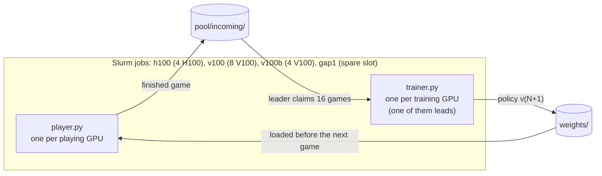

# How the always-on Werewolf training works

This document explains how the scripts in `scripts/training/werewolf_continuous/`
train the MatrixChat Werewolf model around the clock on Rosie. It covers what runs
where, how played games become training steps and new weights, and how the run keeps
its GPUs through Slurm's 24-hour job limit.

For every setting, file and command, see the loop's
[README](../scripts/training/werewolf_continuous/README.md). For the RL method itself
(rewards, critic, PPO), see [WEREWOLF_RL_PLAN.md](../WEREWOLF_RL_PLAN.md).

---

## In short

The run holds 16 GPUs as three Slurm jobs that are renewed forever: one with 4 H100s
and two with V100s (8 and 4).

- On every job, half the GPUs **play** Werewolf games with the newest policy. The other
  half **train** on those games with PPO.
- Finished games go into a shared folder. A training step takes 16 of them, computes an
  update and publishes new weights. Players load the new weights before their next game.
- The processes never talk to each other directly. They coordinate only through files in
  one run directory on `/home`. So GPUs on different machines and of different types can
  join, leave or crash without stopping the rest.
- A cron job on the login node, the **keeper**, keeps two weeks of follow-up jobs queued.
  That makes the run first in line every time one of its 24-hour jobs ends.



---

## 1. What a game is

* Six players, one of them the secret Werewolf. All six are played by the **same model**:
  the SFT checkpoint `checkpoints/checkpoint` (Qwen3-4B-Instruct with the MatrixChat
  matrix interface) plus the adapters being trained.
* The players share one **matrix**. Each player is a row and each column is one time step.
  At every step each player either speaks (adds a word) or stays silent, so they can talk
  at the same time. One KV-cached forward pass moves everyone forward by one column.
* **Day:** free discussion (at most 600 columns), then everyone must vote for another
  living player. The player with the most votes is out, and ties are decided by lot.
  **Night:** the Werewolf picks who to kill.
* **Who wins:** the Village wins when the Werewolf is voted out. The Werewolf wins when
  every Villager is dead. With 6 players a game lasts at most 3 days: vote, kill, vote,
  kill, vote. The last vote is 1 against 1, so it is always a tie.
* The rules and sampling settings live in the run's `game_config.json`, which every
  player and trainer reads.

A game is **recorded**: every sampled action (speak or stay silent, each word, each vote)
is saved with the probability it had when it was sampled. The trainer can then recompute
exactly the same distribution. A recorded game is the RL rollout.

## 2. Playing: `player.py`

Every playing GPU runs one `player.py`, which repeats these steps:

1. Stop if the run is stopped or paused (`RUN/STOP`, `RUN/PAUSE`).
2. Load the newest policy if the trainers have published one (`weights/LATEST`).
3. Wait if the pool already holds 64 fresh games, because more would go stale before
   anyone trains on them.
4. Check that one more game fits in the job's remaining time. The estimate is the
   average game time on this GPU type plus 5%. If it doesn't fit, keep the GPU idle until
   the job's time limit.
5. Play one recorded game and save it to `pool/incoming/`.

A file name says who played it: `v000012_dh-dgx1-2_v100j303114s5_<seed>.pt` is a game
by policy version 12 on dh-dgx1-2, a V100 in job 303114, GPU slot 5.

## 3. Training: `trainer.py` and `training/werewolf_rl/distributed.py`

Every training GPU runs the same `trainer.py`. The trainer that holds the **lease**
(`train/leader.json`, renewed every few seconds) is the **leader**. It runs the step
and also does its own share of the work. The others help with whatever it assigns them.

One training step:

| Phase | Who | What happens |
|---|---|---|
| Claim | leader | Takes 16 games from the pool, oldest first, but only games played by the current or the previous policy version. Older games are archived unused. |
| Prep | all trainers | Each game goes to one trainer; faster GPUs get more games, based on measured times. That trainer recomputes the old policy's and the frozen SFT reference's log-probabilities, plus the critic's inputs. |
| Advantages | leader | Critic values, then turn-level GAE for the round-level and game-level rewards, normalized per role, then mixed 50/50. |
| PPO epochs (×2) | all trainers | Each trainer writes the gradients for its games to a file. The leader adds them up, updates the critic, clips, and takes the optimizer step. |
| Publish | leader | Writes `weights/policy_v(N+1).pt` for the players, archives the games, saves a checkpoint (`learner/step_*`) and appends one line to `learner/metrics.jsonl`. |

Details worth knowing:

* **No NCCL.** NCCL needs a fixed set of GPUs on a fast network. Here the trainers sit
  on different machines and GPU types and come and go, so gradients are exchanged as
  files instead. That is slower but very forgiving.
* **A game stays on one GPU.** The trainer that preps a game also computes its
  gradients in every epoch, so its PPO ratios never mix H100 (bf16) and V100 (fp16)
  numbers.
* **What is trained:** the LoRA adapters plus the matrix-interface modules, about 16.8M
  parameters. The KL penalty keeps the policy close to the frozen SFT checkpoint.
* **What is rewarded:** a penalty for bad conversation habits (talking over others,
  monologues, hogging the discussion), a reward each round for voting well for your team
  and for drawing few votes against yourself, and +1 or -1 for winning or losing the
  game. See WEREWOLF_RL_PLAN.md.

### When a trainer disappears

* Every trainer and player rewrites a **heartbeat** file every 20 s. If a trainer's
  heartbeat is older than 120 s, or it left on SIGTERM, its unfinished games go to the
  others. The step still trains on all 16 games.
* If the leader's job is about to end, it hands the lease to another trainer. If the
  leader dies, its lease goes stale after 180 s and another trainer takes over from the
  last checkpoint. A checkpoint is saved every step, so at most the step in progress is
  lost, and its games go back into the pool.
* **Node clocks on Rosie disagree** by a minute or more. So liveness is never judged by
  comparing two machines' clocks. A reader compares each file's modification time, which
  the file server stamps, with a probe file it has just written itself.

---

## 4. Keeping the GPUs on Rosie

Three Rosie rules shape everything here:

1. Every job has the same priority, so GPUs go to waiting jobs **first come, first
   served**.
2. A job runs for at most **24 hours**.
3. A user may run at most **4 jobs** at once. There is no limit on waiting jobs.

### Chains: `main.sbatch` and `chain.sh`

A **chain** is one GPU allocation kept going as a series of 24-hour jobs with the same
name. The run has three: `h100` (4 H100), `v100` (8 V100) and `v100b` (4 V100).

```
v100:  [job 1: running, 24 h] -> [job 2: queued, starts when 1 ends] -> [job 3] -> ... (14 queued)
```

* Each chain keeps **14 follow-up jobs queued**, each waiting for the one before it to
  end (`--dependency=afterany`).
* When the running job reaches its 24-hour limit, the next one was submitted about two
  weeks earlier. That makes it older than anything other users have queued since, so it
  gets the freed GPUs, and the chain keeps them.
* Never cancel a single queued follow-up: the one behind it would start at once. Stop or
  pause the whole run with `stop.sh`.

Slurm freezes a batch script when the job is submitted, and jobs here are queued two
weeks ahead. So `main.sbatch` does almost nothing itself: it sources `chain.sh`, which is
read when each job **starts**. Fixes and settings therefore reach jobs that were queued
long ago. When a chain job starts, `chain.sh`:

1. reads the run's settings (`RUN/launch.env`, written by `start.sh`);
2. finds a Python that can run torch on this node's GPUs (see "Python on the GPU nodes"
   below);
3. runs the **chain guard**, which stops the chain if `STOP` exists and counts crashed
   jobs;
4. tops the chain's queue back up to 14 follow-ups;
5. sends a `gpu` alert (which GPUs, where, whether they work);
6. starts `trainer.py` on the first half of the GPUs and `player.py` on the rest. A
   process that fails is restarted after 30 s, up to 3 times.

### Holding on to the GPUs when something breaks

A main-chain job never gives its GPUs back before its time limit, except when the run is
stopped. If something breaks, the job keeps the GPUs **held but idle**, and sends an
alert, instead of handing them to the next user in line:

* a process that crashed 3 times, or exited early;
* a node with no working Python for its GPUs;
* a chain whose last 3 jobs crashed;
* `chain.sh` itself being unreadable or broken in the middle of an edit (`main.sbatch`
  then retries it every minute).

After you fix the cause, rerunning `start.sh` restarts every idle GPU in place within a
minute, without releasing it. `status.sh` lists idle GPUs as `IDLE (GPUs kept)`.

### The keeper: `training/werewolf_rl/keeper.py`

The keeper runs from cron on the login node every 5 minutes. Its decisions are logged in
`RUN/keeper/keeper.log`. Each run of it:

* **tops up the chains:** it re-creates a chain that has no jobs left and refills every
  chain's queue;
* **runs a gap job** while a chain is between jobs (its next job still waiting). The
  fourth job slot then runs a `gap1` job on whatever GPUs are free, up to the number the
  chains are missing. The gap job is ended when the chain's own job starts again;
* **runs an extra job** while all three chains hold their GPUs. The fourth slot then
  takes spare H100s or V100s that no other user's waiting job could use:
  * the extra job checks every minute whether another user's waiting job would fit in its
    GPUs and couldn't start without them. If so, it cancels itself, which frees all its
    GPUs at once, and sends an alert. The keeper later re-takes whatever is still free;
  * there is only one spare slot, so when both kinds are free it picks the hole that does
    the most work. An H100 counts as 2.3 V100s, as measured on run1;
  * the chains' own 4 H100 + 12 V100 are never given back;
* **sends the hourly report** to your phone.

### Python on the GPU nodes

The repo's `.venv` doesn't run on the DGX nodes: its interpreter is missing there, and
its torch build needs a newer NVIDIA driver than the V100 nodes have. So every job tries
these Pythons in order and uses the first one that can run a small fp16 attention on its
GPU:

1. `.venv`;
2. a copy of the same interpreter on `/home` that uses `.venv`'s packages;
3. the same, plus a CUDA 12.6 build of torch for the V100s.

On the two V100 nodes with the older driver (525), NVIDIA's CUDA compatibility library
is loaded as well. Details are in README section 2.8.

---

## 5. Operating it

All commands run from the repo root on the login node.

| To... | Run |
|---|---|
| start (or restart) a run | `scripts/training/werewolf_continuous/start.sh run1` |
| see what every GPU is doing | `scripts/training/werewolf_continuous/status.sh run1` |
| **pause for a code or config update** | `scripts/training/werewolf_continuous/stop.sh run1 --pause`, make the change, then `start.sh run1` |
| stop for good (gives up the place in the queue) | `scripts/training/werewolf_continuous/stop.sh run1` |
| stop immediately (cancels the running jobs too) | `scripts/training/werewolf_continuous/stop.sh run1 --now` |
| analyze the games played so far | `python scripts/eval/analyze_werewolf_games.py` (`--show N` prints one game) |
| test phone alerts | `python -m training.werewolf_rl.notify test` |

**Pause, don't stop, for updates.**
* `--pause` makes players abandon their game and trainers finish and save their step.
  After that nothing runs, but every job keeps its GPUs and its queued follow-ups.
  `start.sh` then restarts everything with the code on disk within a minute.
* A plain `stop.sh` cancels the queued follow-ups. A later start goes to the back of the
  line.

`start.sh` is safe to rerun at any time. It rewrites the run's settings, resets the
crash counters, restarts idle GPUs, queues anything missing and reinstalls the keeper's
cron line. Settings such as chain sizes, queue depth, trainer and player flags, and game
rules are environment variables for `start.sh` (README section 5).

## 6. Watching it

* **`status.sh run1`** prints one page:
  * GPUs held against the target, per chain;
  * what each GPU is doing (which game and day, or which training step and phase);
  * the policy version and steps per hour;
  * recent game outcomes;
  * the keeper's last actions.
* **Phone alerts** go through [ntfy](https://ntfy.sh). Settings are kept privately in
  `~/.config/werewolf_rl/notify.env`.

  | Alert | When |
  |---|---|
  | `gpu` | A job got GPUs (which, where, whether they work), or an extra job gave GPUs back. |
  | `crash`, `gave_up`, `stopped` | Something broke and GPUs are held idle until it is fixed. |
  | `status` | `stop.sh` or `start.sh` ran ("stopped for updates", "running again", with the queue). |
  | `report` | Hourly summary of every GPU and the training progress. |

* **`learner/metrics.jsonl`** has one line per training step: win rate, game length, how
  much players talk, KL to the SFT policy, PPO clip fraction, critic loss and timings.
* **`analyze_werewolf_games.py`** explains how and why games end:
  * how votes compare with chance;
  * how often discussions hit the column cap;
  * what players claim about themselves;
  * results per policy version;
  * full game transcripts.

## 7. What happens when...

| Situation | What the loop does |
|---|---|
| A player or trainer crashes | It restarts after 30 s, up to 3 times. After that its GPU is held idle, with a `gave_up` alert, until `start.sh`. |
| A trainer vanishes mid-step | After 120 s without a heartbeat its games are reassigned. The step still uses all 16 games. |
| The leader's job is ending | It hands the lease to another trainer, which continues from the last checkpoint. |
| A whole job crashes | The chain's next job takes over and a `crash` alert is sent. After 3 crashed jobs in a row, the GPUs are held idle with a `stopped` alert. |
| A job is about to hit 24 h | No new game or step starts unless it fits. The GPUs stay held until the limit, then the queued follow-up takes them. |
| A node can't run torch on its GPUs | The job holds the GPUs idle and sends `gave_up`. Fix it, then `start.sh`. |
| Code is being edited while jobs start | A job that finds `chain.sh` broken keeps its GPUs and retries every minute. To update cleanly, pause first. |
| Another user needs our spare GPUs | The extra job gives them back within about a minute. The chains' own GPUs are never given back. |

---

## 8. Where things are

**Scripts** (`scripts/training/werewolf_continuous/`)

| File | Role |
|---|---|
| `start.sh` / `stop.sh` / `status.sh` | Start or resume, pause or stop, and the status page. |
| `main.sbatch` | The Slurm job every chain submits. It only calls `chain.sh`. |
| `chain.sh` | Everything a chain job does: settings, Python choice, guard, queue top-up, trainers and players, holding, pausing, giving back extra GPUs. |
| `trainer.py` | One training GPU. Leads or helps (`distributed.py`). |
| `player.py` | One playing GPU. Plays and saves recorded games. |

**Python modules** (`training/werewolf_rl/`)

| Module | Role |
|---|---|
| `game.py` | The Werewolf game in the shared matrix: rules, sampling, recording. Also used by `scripts/eval/werewolf_game.py`. |
| `rewards.py`, `critic.py`, `ppo.py`, `core.py` | Rewards, critic, PPO losses and the model and optimizer setup. Shared with the single-job trainer `scripts/training/train_werewolf_rl.py`. |
| `distributed.py` | The file-based trainers: lease, heartbeats, tasks, gradient files. |
| `continuous.py` | The run directory, game pool, weight publishing, timing and the chain guard. |
| `keeper.py` | Chain top-ups, gap and extra jobs, and giving spare GPUs back. |
| `report.py`, `notify.py` | The status page and hourly report; ntfy alerts. |

**Run directory** (`checkpoints/werewolf_rl/continuous/<run>/`; only `game_config.json`
is in git)

| Path | Contents |
|---|---|
| `game_config.json` | The game rules and sampling settings. |
| `launch.json`, `launch.env` | Chain sizes and job settings, written by `start.sh`. |
| `STOP`, `PAUSE` | Present means stopped or paused. |
| `pool/incoming/`, `pool/claimed/`, `pool/archive/` | Games waiting to be trained on, in use, and done (as readable JSON transcripts). |
| `weights/` | Published policies (`LATEST`, `policy_v*.pt`). |
| `learner/` | Checkpoints (`step_*`) and `metrics.jsonl`. |
| `train/`, `heartbeats/` | Live coordination between trainers: the lease, step tasks and results, liveness. |
| `timing/` | How long every game, task and step took, per GPU type. |
| `chain/`, `keeper/`, `logs/` | Crash counters and idle marks, the keeper's log, one log per process. |

For the full details (every flag, every file, troubleshooting, alert setup), see the
loop's [README](../scripts/training/werewolf_continuous/README.md).
